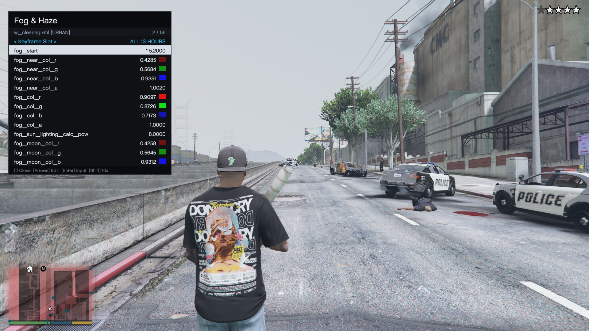
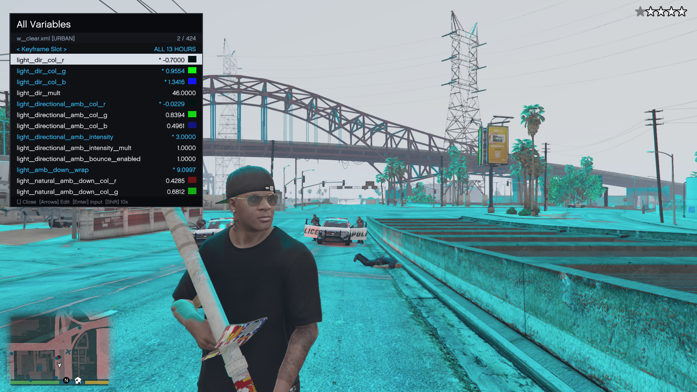

# V Post Cyc - Live Timecycle Editor

An in-game, real-time timecycle editor for GTA V (Legacy and Enhanced), built as an ASI plugin for ScriptHookV.

Edit fog, colors, lighting, reflections, metal shininess, sky, post-processing and more from an in-game menu, see the result instantly, then export or save your XML files.


## Features

- **Live editing** of every weather cycle file (`w_*.xml`) across both regions (`GLOBAL`, `URBAN`) and all 13 time-of-day keyframes.
- **Live editing** of timecycle modifier files (`timecycle_mods_*.xml`), patched in-place in game memory.
- **Quick Edit**: jump straight to the active weather at the current hour.
- **Categories**: Fog & Haze, Metals & Reflections, Lighting & Colors, Sky & Clouds, PostFX & Tone Mapping, Water/Heat/Particles, Shadows/LOD/Misc.
- **Per-variable reset**: restore any single value (or a whole variable across all hours) to its original value.
- **Edit all 13 hours together** or one keyframe at a time.
- **Modifier preview** with adjustable strength.
- **World controls & indicators**: displays the current active weather type in the main menu, cycle list, and weather list; lock time, lock current weather, auto-sync & lock game time to the edited keyframe slot, and clear active modifiers.
- **UI theme & colors**: choose accent color presets or custom RGB + panel opacity in-game (`Editor Settings -> UI Theme & Colors`) and save to `.ini`.
- **Update checker**: check GitHub for newer releases and open the latest releases or GitHub profile page from `Editor Settings`.
- **Non-destructive**: live edits go to a cache folder. Your original files are only changed when you choose **Save** (with automatic backups). **Export** writes to a separate folder.
- **Configurable** toggle key, steps, colors, and UI layout through an `.ini` file.

## Requirements

- GTA V (Legacy `GTA5.exe` or Enhanced `GTA5_Enhanced.exe`)
- [ScriptHookV](http://www.dev-c.com/gtav/scripthookv/) and its ASI loader (`dinput8.dll`)
- Your own `timecycle` XML files (`w_*.xml`, `timecycle_mods_*.xml`). These are not included in this repository due to Rockstar ToS.

## Game Version Compatibility

- Built and tested on the latest GTA V Legacy (`v1.0.3717.0` - "A Safehouse in the Hills" Update). It may also work on `v1.0.3717.0` or lower, though updating to the latest version is recommended when possible.
- **GTA V Enhanced:** Enhanced (`GTA5_Enhanced.exe`) signatures are included in the source, but I do not have Enhanced installed on my PC to test it directly. If it does not work on Enhanced, please report it via GitHub Issues or comments and I will try to help as much as I can.

## Installation

1. Build the project (see below) or download a release.
2. Copy into your GTA V root folder:
   - `TimecycleEditor.asi`
   - `TimecycleEditor.ini`
   - a `timecycle\` folder containing your `w_*.xml` and `timecycle_mods_*.xml` files
3. Launch the game and press `,` to open the menu.

## Controls

| Key | Action |
| --- | --- |
| `,` (configurable) | Open / close menu |
| Up / Down (or Numpad 8 / 2) | Navigate |
| Left / Right (or Numpad 4 / 6) | Change value |
| Enter (or Numpad 5) | Select / type an exact value |
| R or Delete | Reset the selected value to its original |
| Backspace (or Numpad 0) | Back |
| Hold Shift | 10x step |
| Hold Ctrl | 0.1x step |

## Configuration (`TimecycleEditor.ini`)

```ini
[General]
ToggleKey = ,                 ; , . / ; F1-F24 INSERT HOME END A-Z NUMPAD0-9 or hex VK (0xBC)
RedirectFromFolder = true     ; load timecycle files from the folder below
TimecycleFolder = timecycle
ExportFolder = timecycle/export

[Editor]
StepDefault = 0.05
StepFine = 0.005
StepCoarse = 0.50

[UI]
MenuX = 0.015
MenuY = 0.035
MenuWidth = 0.275
MaxVisibleRows = 14
AccentR = 56
AccentG = 189
AccentB = 248
BgAlpha = 238
```

## Save vs Export

| Action | Writes to | Originals touched? |
| --- | --- | --- |
| Live edit | `timecycle/_live/` | No |
| Export All Modified | `timecycle/export/` | No |
| Save All Modified | `timecycle/` | Yes, with backups in `timecycle/backup/` (`.orig`, `.bak1`-`.bak3`) |
| Discard All Live Changes | removes `_live/` | No |

## Screenshots






## Building

Requires Visual Studio (C++ desktop workload) and CMake 3.20+.

```powershell
cmake -S . -B build -A x64 "-DCMAKE_POLICY_VERSION_MINIMUM=3.5"
cmake --build build --config Release
```

Output: `build/bin/TimecycleEditor.asi`

## Troubleshooting

A `TimecycleEditor.log` file is written next to the ASI. It lists which game signatures were found and which files were loaded. If live reload does not work after a game update, the byte patterns in `src/game/signatures.h` likely need updating.

## Nexus Mods, Antivirus False Positives & Open Source

- **Why Nexus Mods downloads contain a `.txt` with the GitHub link:** Original game files cannot be redistributed under Rockstar ToS, and uploading the compiled `.asi` directly to Nexus Mods (in `.zip` or `.rar`) repeatedly triggered false-positive flags on Nexus Mods even when VirusTotal was clean. Download the archive, open the `.txt` file, and grab the release or source from GitHub.
- **VirusTotal false positives:** Compiled `.asi` mods that hook game memory can trigger 2 to 5 false-positive detections out of ~70 vendors on VirusTotal. Because this mod is completely open source, you are encouraged to inspect the source code (or have any LLM/chatbot review it for you), scan it yourself, and compile it from source using the build steps above.

## Credits

- **[fxReloader](https://github.com/crxhvrd/fxReloader)** by CoreFX (GPL-3.0): game signatures, the sim-thread marshal approach, and the in-place modifier patching technique are derived from this project.
- **[MinHook](https://github.com/TsudaKageyu/minhook)** by Tsuda Kageyu (BSD 2-Clause).
- **[ScriptHookV SDK](http://www.dev-c.com/gtav/scripthookv/)** by Alexander Blade.
- **[FiveM / Cfx.re](https://github.com/citizenfx/fivem)** and **[CodeWalker](https://github.com/dexyfex/CodeWalker)**: used as references for timecycle structures and formats.

## License

GPL-3.0. See [LICENSE](LICENSE).
